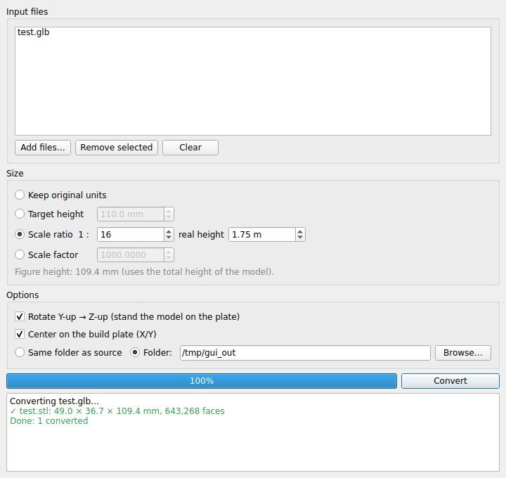

# glb2stl

[](https://buymeacoffee.com/renero82)

Convert **GLB / glTF** 3D models to **STL**, ready for 3D printing.
Available as a **desktop app** and as a **command line tool**.

Made for models generated by AI tools (Meshy, etc.) and exported as GLB: it merges the scene,
fixes the orientation, puts the model on the build plate and scales it to the size you want,
including classic miniature scales like 1:16 or 1:35 - for figures (by height) and for
vehicles, ships and aircraft (by length or width).



## Download

Ready-to-use apps are attached to every [release](https://github.com/renero82/glb2stl/releases/latest),
no Python needed:

- **macOS (Apple Silicon)**: `glb2stl-vX.Y.Z-macos-arm64.zip` - unzip and drag `glb2stl.app` to Applications
- **Windows installer** (recommended): `glb2stl-vX.Y.Z-windows-setup.exe` - installs for your user
  only (no admin rights needed), adds a Start menu entry, an uninstaller and, optionally,
  "Open with glb2stl" for `.glb` / `.gltf` files
- **Windows portable**: `glb2stl-vX.Y.Z-windows-portable.exe` - a single file, nothing to install

The apps are not signed, so the first time the system will warn you:

- **macOS**: right-click the app → **Open** → **Open**. If macOS says the app is damaged, run
  `xattr -dr com.apple.quarantine /Applications/glb2stl.app` once.
- **Windows**: in the SmartScreen dialog click **More info** → **Run anyway**. With the installer
  this happens only once, when you run the setup: the installed app starts without warnings.

## Why

GLB files use **meters** and a **Y-up** axis. STL has no units and slicers read it as
**millimeters** with **Z up**. Converted as-is, a 1.9 m figure shows up in your slicer
1.9 mm tall and lying on its back. `glb2stl` handles both issues.

## Installation

```bash
git clone https://github.com/renero82/glb2stl.git
cd glb2stl
pip install ".[gui]"        # command line + desktop app
# pip install .             # command line only (no PySide6)
```

This installs two commands: `glb2stl` (CLI) and `glb2stl-gui` (desktop app).

Without installing, you can also run the scripts from the folder:

```bash
pip install -r requirements-gui.txt
python3 glb2stl_gui.py
python3 glb2stl.py model.glb --ratio 1:16
```

## Desktop app

```bash
glb2stl-gui
```

1. Drag `.glb` / `.gltf` files (or whole folders) into the window, or use **Add files…**
2. Choose the size: target size in mm, scale ratio 1:N with the real-world size,
   or a plain scale factor. With **Measure along** pick the reference dimension:
   *Height* for figures, *Length* or *Width* for vehicles. The window shows the resulting size.
3. Choose where to save the STL files and press **Convert**.

The log shows the final size of every model and warns you about non-watertight meshes.
Your settings are remembered for the next session.

## Command line

```bash
# basic conversion (model.glb -> model.stl)
glb2stl model.glb

# target height in mm
glb2stl model.glb -o figure.stl --height 110

# miniature scale: 1:16 of a 1.75 m person (default real height)
glb2stl soldier.glb --ratio 1:16

# 1:35 scale, 1.80 m real height, a whole folder into ./stl
glb2stl *.glb --ratio 1:35 --real-size 1.80 -o stl/

# vehicles: 1:35 of a tank 5.84 m long
glb2stl sherman.glb --ratio 1:35 --axis length --real-size 5.84

# vehicles: just make it 167 mm long
glb2stl sherman.glb --length 167
```

| Option | Description |
|---|---|
| `--height MM` | target height in millimeters |
| `--length MM` | target length in millimeters (long side seen from above) |
| `--width MM` | target width in millimeters (short side seen from above) |
| `--ratio 1:N` | scale ratio (`1:16`, `1/35`, `16`) based on `--real-size` and `--axis` |
| `--axis A` | reference dimension for `--ratio`: `height` (default), `length`, `width` |
| `--real-size M` | real-world size in meters along `--axis` (default `1.75`, a person's height; required with `length`/`width`). `--real-height` still works |
| `--scale F` | plain scale factor (e.g. `1000` for meters to mm) |
| `-o PATH` | output file, or output directory with multiple inputs |
| `--no-rotate` | keep the original orientation (model already Z-up) |
| `--no-center` | do not center the model on X/Y |

## Building the apps

Releases are built automatically by GitHub Actions: pushing a tag like `v2.1.0` builds the
macOS and Windows apps and attaches them to the release. To build the macOS app locally:

```bash
./scripts/build_macos.sh          # macOS  -> dist/glb2stl.app
```

```powershell
.\scripts\build_windows.ps1        # Windows -> portable exe, folder build and (with Inno Setup) the installer
```

Every build is checked by running the packaged app with `--selftest` (it loads the GUI,
converts a test model and checks the size); the release is published only if it passes.
You can run it yourself too:

```bash
dist/glb2stl.app/Contents/MacOS/glb2stl --selftest     # macOS
glb2stl.exe --selftest report.txt                      # Windows (writes the result to report.txt)
```

On Windows the workflow also installs the app with the setup in silent mode, runs the
selftest on the installed copy and uninstalls it.

PyInstaller cannot cross-compile: the Windows `.exe` must be built on Windows
(or by the GitHub workflow).

## Using it from Python

```python
from glb2stl import convert

result = convert("soldier.glb", "soldier.stl", ratio=16, real_size=1.75)
print(result.size_mm, result.watertight, result.warnings)

# vehicles: scale by length
convert("tiger.glb", "tiger.stl", ratio=35, axis="length", real_size=6.32)
```

## Notes

- STL stores geometry only: colors and textures from the GLB are dropped.
- With `height` the ratio uses the **total height of the model**. For figures that are crouching,
  bent over or wearing a hat, adjust the real height or set the target height directly.
- `length` and `width` are the sides of the smallest rectangle around the model seen from
  above, so a vehicle is measured correctly even if it is turned on the plate.
- Use the same kind of measure as the real data: a tank's length is often quoted
  **with the gun forward** and as **hull only**; if the model's gun overhangs, use the length
  with gun, and if the turret is turned sideways, prefer `width` or the hull length on a
  model without the barrel.

## Guida rapida (Italiano)

Converte file GLB/glTF in STL pronti per la stampa 3D: unisce la scena, mette il modello
in piedi, lo appoggia sul piano e lo scala. Dalla 2.0 c'è anche l'app con interfaccia grafica.

Dalla 2.3 la scala 1:N funziona anche per i mezzi: si sceglie la misura di riferimento
(altezza per i figurini, lunghezza o larghezza per carri, auto, navi e aerei), ad esempio
`glb2stl sherman.glb --ratio 1:35 --axis length --real-size 5.84`.

```bash
pip install ".[gui]"
glb2stl-gui
```

## Code signing

Free code signing for the Windows builds is planned through the [SignPath Foundation](https://signpath.org).
It is not active yet: current releases are unsigned. See the [code signing policy](CODE_SIGNING.md)
for status, roles and privacy policy.

## License

[MIT](LICENSE)
